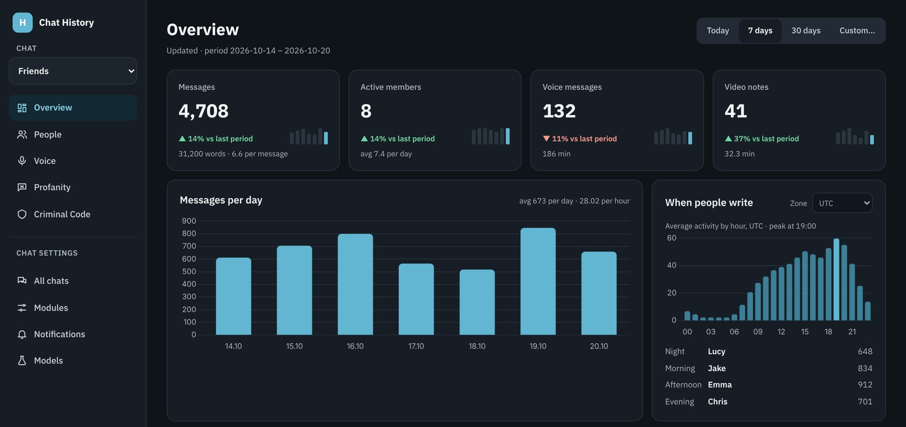

# Telegram Group Statistics & Analytics — History Bot

**See who is active in your Telegram group, what people discuss, and when conversation peaks.** History Bot is an MIT-licensed open-source Telegram group analytics bot with activity statistics, message/word counts, top members, voice-note stats and optional summaries.

**Try it without deploying anything:** [Add @stat_history_bot to your group](https://t.me/stat_history_bot?startgroup=true) · [See screenshots and features](https://tghistory.thesunwave.space/) · [Compare with Combot](https://tghistory.thesunwave.space/combot-alternative)



Once added, use `/help` to see commands and `/top` or `/activity_week` for group statistics. Statistics build up from messages the bot is allowed to receive; it cannot reconstruct messages sent before it joined. Bot privacy settings may affect which group messages Telegram delivers.

**Prefer full control?** [Deploy your own instance to Cloudflare](https://deploy.workers.cloudflare.com/?url=https://github.com/thesunwave/telegram_history_bot). Self-hosting requires your own Telegram bot token and Cloudflare account; the steps are below. History Bot is primarily a *statistics* tool, not a substitute for moderation or anti-spam bots.

The root `wrangler.jsonc` is a portable self-hosting template. The owner's
existing Cloudflare Worker uses the separate `wrangler.production.jsonc` and
is deployed only from a reviewed GitHub release. See the
[release and self-hosting guide](docs/ops/release-and-self-hosting.md).

The public landing is maintained and released independently in
[telegram_history_landing](https://github.com/thesunwave/telegram_history_landing).
The owner's production config retains the `LANDING` service binding, custom
domain, and legacy webhook endpoint. Public installations do not require a
landing Worker or any owner-specific Cloudflare resource IDs.

Public marketing URLs are proxied from the separate landing Worker: `/` is the
canonical English home, `/ru` is Russian, and `/combot-alternative` is an
analytics comparison page. The same binding serves `/robots.txt`, `/sitemap.xml`
and `/landing/*` assets; old `/en` links redirect permanently to `/`. Login,
admin and Telegram webhook routes stay exclusively in this bot Worker.

[](https://deploy.workers.cloudflare.com/?url=https://github.com/thesunwave/telegram_history_bot)

## Install your own bot (Cloudflare)

1. Create a bot with [@BotFather](https://t.me/BotFather) and copy its token.
2. Click **Deploy to Cloudflare**, select your own Cloudflare account, and enter
   the `TOKEN` secret. The source repository is copied into your own GitHub
   repository; it is not linked to the owner's production account.
3. Leave the pre-filled deploy command as **`npm run deploy`** (Cloudflare
   reads it from `package.json`; do not replace it with plain
   `wrangler deploy`). It provisions the KV, D1 and Durable Objects bindings,
   then applies the D1 migrations. Nothing else needs to be configured: no
   extra secrets, AI keys or manual migrations are required for Basic mode.
4. Open your new Worker's URL. It redirects to `/admin/setup`. Sign in with
   the same BotFather token and verify that D1 is ready. **Choose and save your
   storage mode**, then enable any features you want before selecting
   **Connect webhook**. This step registers the public Worker URL with Telegram.
5. Add the bot to your group. To allow it to collect ordinary group messages
   rather than just commands, disable bot privacy using BotFather's
   `/setprivacy` and re-add the bot to the group.

New installations **require an explicit storage decision** before Telegram is connected:
- **Statistics only:** count messages, words, media and activity without saving
  the raw text of chats in the bot's message-history KV/DO storage. Chat/user
  identifiers, group metadata and (when activity tracking is enabled) counts
  still persist. This does not control
  Telegram/Cloudflare platform logs or optional external AI providers.
  AI summaries, contextual criminal analysis, and their history-dependent
  commands are unavailable in this mode.
- **Message history + statistics:** save raw messages temporarily in your Cloudflare
  Durable Objects/KV (seven-day date-based retention by default) to allow
  AI summaries, context analysis and replay.

The owner can turn activity statistics, profanity analysis, criminal analysis and
AI summaries on/off in `/admin/setup`; AI-dependent features may transmit content
to their configured model provider. All advanced analyses initially start off.
Switching to stats-only stops **new raw message writes**, but does not purge
previously stored messages; they age out under their retention policy. This page
controls the entire self-hosted bot instance, not individual Telegram groups.
On existing installations, the configured `ADMIN_USER_ID` can open `/admin/setup`
with the regular Telegram session. If no owner ID is configured, the Telegram
account may be linked **once** by confirming the BotFather token; the binding is
stored in D1, and future visits use Telegram Login automatically. Group admins
are not owners unless explicitly linked. No Basic Auth is required for settings.
When Telegram Login is enabled, BotFather-token sessions cannot be used to
change settings; the token is accepted only for the one-time owner pairing.
Standalone installations without Telegram Login retain the token bootstrap.
You can enable AI summaries after configuring any required provider key as a
Cloudflare Secret. Never paste an OpenAI/OpenRouter key into the dashboard.

The first-run flow can be rehearsed locally with a dummy token and no
production changes using `npm ci && npm run test:onboarding`. The smoke
test does not register a webhook; its status request may query Telegram's
`getWebhookInfo` with the dummy token.
See [the self-hosting guide](docs/ops/release-and-self-hosting.md) for
upgrades and troubleshooting.

Use [@stat_history_bot](https://t.me/stat_history_bot?startgroup=true) in a Telegram
group, or deploy an independent copy with the button. Cloudflare creates a new
repository and provisions its own KV, D1, Durable Objects and Workers AI.
Provide the `TOKEN` secret from BotFather during setup, then open
`https://YOUR-WORKER.workers.dev/admin/setup` to connect the Telegram webhook.
The deploy command applies D1 migrations automatically.

Cloudflare Worker that stores Telegram chat messages (7 days in KV), generates summaries, and optionally runs profanity/criminal analysis with notifications. Supports Cloudflare AI and OpenAI providers, and includes an **optimized summary system** with parallel processing, context optimization, and automatic fallback.

## Privacy and data

The bot needs to see group messages to count them, so here is exactly what it keeps.
The storage mode is set in `/admin/setup` for the whole instance. It can be changed
later, but switching to statistics-only does not purge existing history; it
expires under the retention policy.

- **Statistics only:** no message text is stored. The bot keeps chat and user
  ids, usernames, the group title and per-day counters (messages, words, media,
  active hours, and profanity words if that analysis is on).
- **Message history + statistics:** in addition, raw message text is kept for
  seven days by default (`RAW_MESSAGE_RETENTION_DAYS`) and then deleted
  automatically. It is needed for AI summaries and context analysis.
- **Summaries and criminal-analysis results** are removed by the daily cleanup
  after 30 days (a failed or skipped cleanup run leaves them longer); analysis results may include short quotes. Both are off by
  default on a new self-hosted install; the hosted @stat_history_bot runs
  criminal analysis.
- Counters and usernames do not expire automatically yet.
- A group that enables **achievements** keeps its group ID, weekly activity totals
  and earned badges. Members participate automatically when the bot observes
  their activity. A personal album saves the member's Telegram ID for that group,
  badge progress, unlock dates and results. The comeback badge uses the last message
  timestamp and stores the member's choice to allow a public reply. A pending announcement also stores the
  target message and topic IDs. In a private chat, open `/badges`, choose
  the group and confirm **Удалить мой альбом** to erase its progress, awards and reply evidence.
- When a group enables **conversation badges** and a member opts in, D1 records
  the group, message and author IDs and timestamps for that member's new messages.
  A direct reply also records the parent message ID, author ID and timestamp when
  both authors have opted in. Scoring uses a rolling 28-day window. Daily cleanup
  deletes older records. **Прекратить учёт ответов** in the private album removes
  the member's evidence and links to their messages while preserving earned badges.
  Disabling the conversation shelf in the group's `/achievements` menu removes
  the group's reply evidence and consent settings.

**Forwards.** The dashboard’s Forwards tab ranks members and sources by the number
of manual forwards in a group during the selected period. This includes media.
The data starts when the feature is enabled and follows the activity-tracking setting.
The bot keeps the forwarding member and the day, plus the destination message ID
to deduplicate deliveries. For channel sources it keeps the channel ID, title and
username when supplied. Person and other sources are counted by category.
Forwarded content, original message IDs and original user details are discarded.
Forward records follow the same retention as the activity counters and are cleared
by `/reset`.

**Where it lives.** With [@stat_history_bot](https://t.me/stat_history_bot) the
data is in the maintainer's Cloudflare account. With your own instance it is only
in your Cloudflare account (KV, D1, Durable Objects). AI features are off by
default; when you enable one, the text it processes is sent to the provider you
configure (Workers AI, OpenAI, OpenRouter, etc.). Telegram and Cloudflare also
see the data as platforms, and their backups and logs are outside the bot's control.

**Dashboard access.** Chat names, settings and activity counters are listed only
when Telegram confirms your membership. If that check fails, the chat is hidden
until a later successful check. Chats configured for administrators-only dashboard
access are listed and accessible only to confirmed chat administrators. A private
conversation with the bot is accessible only to the Telegram user who owns it.

The separate **bot-owner installation directory** lists metadata for all known
chats, including private dialogs: names/usernames, chat IDs, chat type, bot membership
status/dates and the last-message timestamp. This directory is visible only to the
configured or paired bot owner through Telegram sign-in. It does not grant access
to other users' private message content or their chat statistics dashboards.

**Deleting it.** `/reset` clears all counters for the chat; `/profanity_reset`
and `/criminal_reset` clear those analyses. Removing the bot stops collection,
and stored message text then expires with the retention period. One-step
deletion of everything about a chat, including usernames and metadata, is
tracked in [#173](https://github.com/thesunwave/telegram_history_bot/issues/173).
On your own instance you can also delete anything from the Cloudflare dashboard.

The anonymous install ping is described [below](#anonymous-usage-ping).

## Features

- Webhook for receiving Telegram updates.
- Optional message history in Durable Objects/KV, with seven-day default
  retention (daily blocks + fallback single-message storage). Stats Only does
  not write raw messages to those stores.
- Per-user counters via Durable Objects, stored as daily aggregates in D1.
- **🚀 Optimized Summary System** with parallel processing and context management.
- **🛡️ Automatic fallback** to legacy summarization on errors.
- Optional profanity and criminal-code analysis with notification flows.
- D1 storage for violation history and summaries.
- Daily cron job triggers scheduled summaries.
- Admin bot-installation list with chat names, membership status, latest installation,
  status-change and last-message dates. See [installation tracking](docs/guides/bot-installations.md).

## Commands

### Achievement albums

In a group, an administrator opens `/achievements` and enables the shared collection.
The bot owner can also enable it on the **Установки бота** (Bot installations)
page in the **Достижения** (Achievements) column for a connected group.
After the first complete Monday–Sunday UTC week with verified activity the bot can post
a weekly photo. The group can earn six badges, including **Choir** when four different
participants send voice notes in the same week. The weekly photo is safe to forward and
contains group totals only.

Open `/badges` in private or tap **Мои бейджи** in the group to view your personal album.
Members participate automatically when they post in a group with achievements enabled.
Daily badges count verified days from the next UTC midnight. Personal badges cover
participation, time of day, voice and video notes, manual channel reposts and returning to the chat.
The album owner can open it and choose a badge to share. Pausing keeps unlocks, and
deleting an album removes that person's achievement progress and awards for that group.

**Rise from Read-Only** (**Восстание из ридонли**) unlocks as soon as a participant
posts again after at least 30 days in the same group. A qualifying gap starts with
a previous message in the same group, including one already recorded before achievements
were enabled. After a participant enables the
announcement in their private album, the bot replies to the returning message
with a card in the group. The badge can be earned once per album.
If Telegram explicitly rate-limits the card, the achievement job can retry it
within 24 hours while the announcement remains enabled.

Groups and individual participants can separately enable the conversation shelf.
Four badges are visible up front, and a rare paired badge appears when earned.
For example, **Spark** recognizes three different participants replying directly to the
same message within 48 hours. This uses message and parent IDs, author IDs and timestamps
from eligible participants. The evidence window is 28 days, with scheduled expiry.
Albums and cards work in Statistics Only mode.

In the web dashboard, select a group and open **Achievements** (**Достижения**).
The group collection shows which week earned each badge. **My album** shows your
personal unlocks and progress for that group. Use the Telegram commands above to
start or manage a collection.

**Upgrading self-hosted installations.** Run `npm run deploy:upgrade` to apply the
D1 migrations before publishing the Worker. Include the `*/5 * * * *` scheduled
trigger alongside the existing daily trigger. The current
self-hosting template sets `ENABLE_CONVERSATION_ACHIEVEMENTS=true`. For an existing
installation, set this flag to offer conversation badges. Each group and member still
has to opt in before reply tracking starts. If commands work but inline buttons do
not respond, the owner can check the webhook subscription at `/admin/setup`. For a
DNS-based registration on this Worker's webhook with a known secret and no custom
certificate, the repair button adds `callback_query` to the existing update list.
For a manually pinned IP, custom certificate or different endpoint, re-register with
the original URL, webhook secret and delivery options, adding `callback_query`.
Keep pending updates when re-registering. The instance must have
activity tracking enabled and Telegram must deliver ordinary group messages.

To evaluate initial thresholds against an authorized local SQLite copy of D1, run
`node --experimental-strip-types scripts/calibrate-achievements.mjs SNAPSHOT.sqlite FROM TO`
with closed UTC dates in YYYY-MM-DD format. The tool reads the snapshot and emits cohort
counts and unlock rates. Offline results exclude live coverage that requires a matching
Durable Object proof.

### Statistics and settings

- `/summary <days>` – summary for last N days (default 1)
- `/summary_last <n>` – summary of last N messages (default 100, max 1000)
- `/top <n>` – top N active users for today (default 5)
- `/profanity_top [n] [period]` – top N profanity users (today|week|month)
- `/profanity_words [n] [period]` – top N profanity words (today|week|month)
- `/my_profanity [period]` – your profanity stats (today|week|month)
- `/profanity_chart_week` – profanity chart for week
- `/profanity_chart_month` – profanity chart for month
- `/profanity_reset` – reset profanity counters for chat
- `/criminal_stats [period]` – criminal violations stats (today|week|month)
- `/my_criminal [period]` – your criminal stats (today|week|month)
- `/criminal_top [n] [period]` – top N criminal violations
- `/criminal_reset` – reset criminal counters for chat
- `/auto_notifications ...` – manage automatic notifications
- `/reset` – reset all counters for the current chat
- `/activity_week` – activity chart for week
- `/activity_month` – activity chart for month
- `/activity_users_week` – per-user activity for week
- `/activity_users_month` – per-user activity for month
- `/help` – show full list

To enable autocomplete, register the commands with **BotFather** via `/setcommands` and provide the list above (one per line).

## 🚀 Optimized Summary System

### Overview

The bot includes an **optimized summary system** that improves performance and quality for large message volumes:

- **Parallel Processing**: Uses Durable Objects to fetch messages concurrently
- **Context Optimization**: High token budgets with configurable limits
- **Hierarchical Processing**: Two-stage summarization for large datasets
- **Automatic Fallback**: Seamlessly falls back to legacy system on errors

### Configuration

The optimized system is **enabled by default** and configured via environment variables:

```bash
# Feature flag (default: true)
SUMMARY_OPT_ENABLED=true

# Parallel processing (default: 5 workers, 50 batch size)
SUMMARY_OPT_MAX_WORKERS=5
SUMMARY_OPT_WORKER_BATCH_SIZE=50

# Context management (default: 120k tokens)
SUMMARY_OPT_MAX_TOKENS_PER_REQUEST=120000
SUMMARY_OPT_TOKEN_ESTIMATION_FACTOR=4

# Hierarchical processing (default: enabled at 80k tokens)
SUMMARY_OPT_HIERARCHICAL_ENABLED=true
SUMMARY_OPT_CHUNK_SIZE_THRESHOLD=80000
```

### Monitoring

Enable detailed monitoring to track performance:

```bash
wrangler tail --format=pretty | grep "Optimized summary"
```

Look for log messages:
- `"Attempting optimized summary"` - System activated
- `"Optimized summary completed successfully"` - Success
- `"Optimized summary failed, falling back to legacy"` - Fallback triggered

### Troubleshooting

**Emergency disable**: Set `SUMMARY_OPT_ENABLED=false` and redeploy.

**Common issues**:
- Configuration validation errors → Reset invalid env vars to defaults
- Frequent fallbacks → Check Workers AI quotas and network stability  
- Performance issues → Reduce `SUMMARY_OPT_MAX_WORKERS` to 3

For detailed documentation, see `docs/README.md`.

## Configuration & Deployment

**Cloudflare (recommended):** click Deploy to Cloudflare above, supply the
BotFather `TOKEN` secret, and complete `/admin/setup` after deployment.
Only the token is required for Basic mode. OpenAI/OpenRouter API keys are
optional Cloudflare Secrets; never place their values in Git or D1.

**Local development:**

```sh
npm ci
cp .dev.vars.example .dev.vars
# Enter your BotFather TOKEN in .dev.vars (ignored by Git)
npm run dev
```

**CLI deployment:** for a new installation, configure `TOKEN` as a Worker Secret,
then run `npm run deploy` to provision the bindings and apply the D1 migrations.
For upgrades, keep the installation's existing bindings and use `npm run deploy:upgrade`.
If Workers Builds deploys your updates automatically, set its deploy command to
`npm run deploy:upgrade` before merging the upgrade.

### Anonymous usage ping

To count how many self-hosted bots are running, each install sends one
anonymous request a day (after the daily summary cron) to
`https://tghistory.thesunwave.space/telemetry/v1/ping`. It contains only:

- a random install id, created on the first daily ping and stored in your D1 `app_settings`;
- how many chats and groups were active in the last 7 days, as a range
  (`0`, `1`, `2-5`, `6-20`, `21-100`, `100+`).

It never contains chat or user ids, messages, usernames, your bot token or
bot name, and the receiver does not store IP addresses. The source is in
`src/features/telemetry/telemetry.ts`. To opt out, set the Worker variable
`TELEMETRY_DISABLED=true` (Cloudflare dashboard → your Worker → Settings →
Variables, or `vars` in `wrangler.jsonc`).

## Development

Run unit tests with:

```bash
npm test
```

Run `npm install` before `npm test` to ensure dev dependencies like Vitest are available.

## Docs

See `docs/README.md` for documentation structure and naming rules.

## License

History Bot is released under the [MIT License](LICENSE). Copyright © 2026 Artur Malev.

